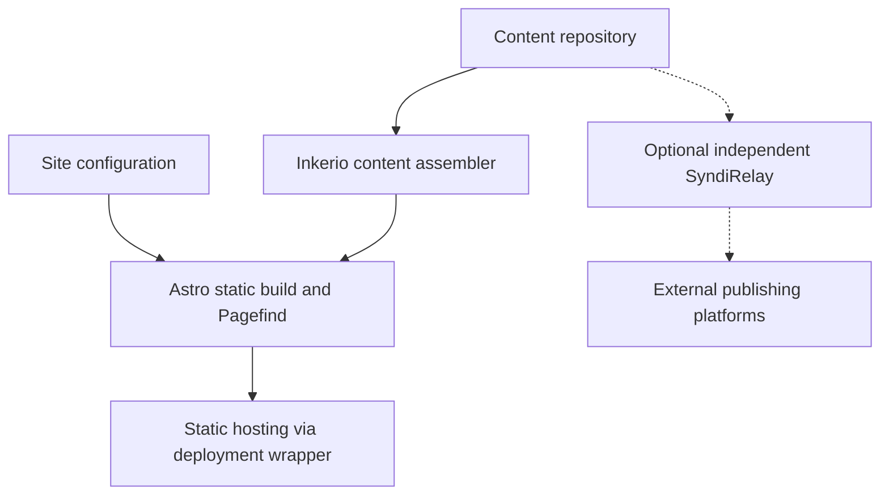

# How content becomes a website

Inkerio turns a separately versioned content repository into a bilingual static website. It assembles the content itself and does not require a Go program or a publishing platform account.

## Data flow

The public [inkerio-content-template](https://github.com/ThinkerQAQ/inkerio-content-template) supplies demonstration content. For your own site, create a separate content repository from the template. See the [tutorial](../tutorial/first-site.md).

## Ownership

| Part | Owns |
| --- | --- |
| Content repository | Markdown, translations, source media, workout records, pages/About, copyright policy and optional manifest |
| Engine `src/` and `astro.config.mjs` | Routes, layouts, metadata, SEO, RSS and collection schemas |
| Engine `scripts/` and `src/markdown/` | Content assembly, diagram rendering and static build support |
| Engine `.github/workflows/` | Public sample validation without private credentials |
| Site deployment wrapper | Site identity, verification assets, private content access, hosting, Workers and optional search notifications |
| SyndiRelay (separate public-source project) | Optional off-site publication, article compilation, Bridge, MCP, browser integration and related search tools |

Run `node scripts/assemble-content.mjs --content-root ../your-content-repo` in the engine root. This copies the source into ignored generated directories. Edit and commit writing in the content checkout, never the assembled copy. The static build writes `dist/` including Pagefind indexes, without requiring an online Go/Astro server at runtime.

## Search, integrations and deployment

Pagefind runs locally in the browser. Optional AI Search, Cloudflare Workers, analytics, comments and external publication require per-site configuration. They are not enabled merely by cloning Inkerio. Publishing copies of articles to external platforms is **not** part of `npm run build`.

In production, a site-specific deployment repository pins Inkerio and content revisions, overlays `site.config.json`, and deploys the `dist/` output. The ThinkerQAQ website is one example of this architecture. See [deployment](../how-to/deploy.md) and [integrations](search-and-integrations.md).
