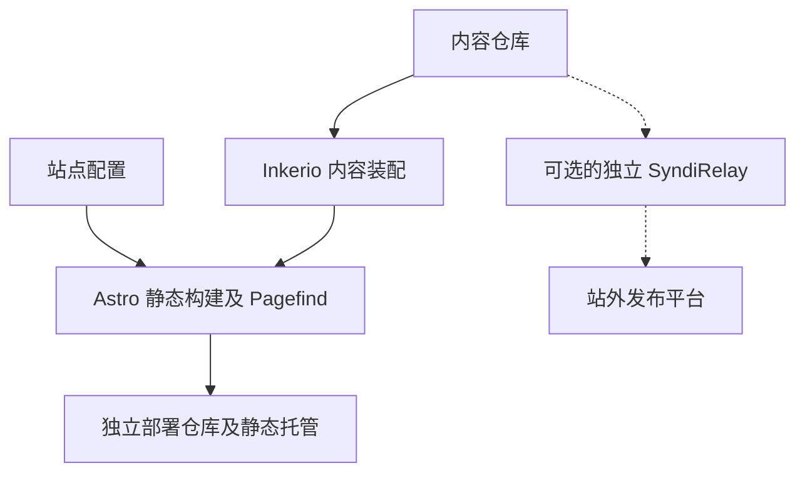

# 内容如何生成网站

Inkerio 将独立内容仓库构建为中英文静态网站，**装配由引擎自带 Node.js 脚本完成**，不依赖 Go、内容分发工具或第三方账号。

## 数据流

公开 [inkerio-content-template](https://github.com/ThinkerQAQ/inkerio-content-template) 只提供演示内容。个人网站应建立自己的内容仓库，按[教程](../tutorial/first-site.md)装配。

## 职责边界

| 组成部分 | 责任 |
| --- | --- |
| 内容仓库 | 文章、笔记、翻译、摄影、About、版权策略、可选内容清单 |
| 引擎 `src/` 与 `astro.config.mjs` | 路由、组件、SEO、RSS、Schema 与静态构建 |
| 引擎 `scripts/` | 内容装配、图表预渲染、索引构建 |
| 引擎 `.github/workflows/` | 仅使用公开样例的 CI 验证 |
| 站点部署仓库 | 站点名称、域名、验证资源、私有内容权限、Worker 与托管部署 |
| SyndiRelay（独立私有项目） | 可选的站外分发、Bridge、MCP、浏览器扩展及搜索提交工具 |

在引擎根目录运行 `node scripts/assemble-content.mjs --content-root ../blog-content`，将源内容复制到 Git 忽略的生成目录；原始内容仍在自己的仓库中维护。`npm run build` 生成 `dist/`，包含 Pagefind 索引；部署后无需常驻 Astro 或 Go 服务。

## 搜索与部署

Pagefind 是静态网站自身的搜索能力；AI Search、Umami、评论、Worker 与站外分发均需独立配置。构建网站不会向第三方平台发布文章。

生产部署由站点专用仓库固定引擎与内容版本、覆盖 `site.config.json`，再将静态产物发布到所选平台。可参考[部署说明](../how-to/deploy.md)与[集成文档](search-and-integrations.md)。
